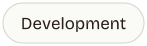
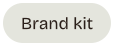
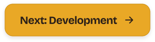

<picture><source media="(prefers-color-scheme: dark)" srcset="docs/brand/readme/headers/contributing-dark.svg"></picture>

  <a href="README.md"><picture><source media="(prefers-color-scheme: dark)" srcset="docs/brand/readme/nav/home-dark.svg"></picture></a>
  <a href="docs/README.md"><picture><source media="(prefers-color-scheme: dark)" srcset="docs/brand/readme/nav/docs-dark.svg"></picture></a>
  <a href="docs/self-hosting.md"><picture><source media="(prefers-color-scheme: dark)" srcset="docs/brand/readme/nav/self-hosting-dark.svg"></picture></a>
  <a href="docs/deploying.md"><picture><source media="(prefers-color-scheme: dark)" srcset="docs/brand/readme/nav/deploying-dark.svg"></picture></a>
  <a href="docs/development.md"><picture><source media="(prefers-color-scheme: dark)" srcset="docs/brand/readme/nav/development-dark.svg"></picture></a>
  <a href="docs/backend-map.md"><picture><source media="(prefers-color-scheme: dark)" srcset="docs/brand/readme/nav/backend-map-dark.svg"></picture></a>
  <a href="docs/brand/README.md"><picture><source media="(prefers-color-scheme: dark)" srcset="docs/brand/readme/nav/brand-dark.svg"></picture></a>

Thanks for your interest! JobBear is an open-source job application tracker, and it is also
a **learning project**: the maintainer writes the core backend (models, endpoints, services,
integrations, migrations and their tests) himself to learn Python backend development.

## What's welcome

| Area | Contributions |
|---|---|
| Bugs | Issues with clear steps to reproduce, always welcome |
| Frontend presentation | Components, styling, accessibility, responsive fixes (`frontend/src/components`, `frontend/src/pages`) |
| Docs | README, guides in `docs/`, typos, diagrams |
| Tooling / CI | GitHub Actions, Docker, lint config |
| Backend core | **Please open an issue to discuss first.** Until v1 ships, backend logic is written by the maintainer; suggestions and reviews are very welcome, finished implementations usually won't be merged |

## Getting set up

[docs/development.md](docs/development.md) covers the architecture, running JobBear locally
(including frontend-only on sample data) and the checks to run before a pull request. CI runs
the same checks on every pull request.

## Conventions

- **Branches:** `feat/<topic>`, `fix/<topic>`, `docs/<topic>`, `chore/<topic>`. Never commit to `main` directly.
- **Commits:** [Conventional Commits](https://www.conventionalcommits.org/) with an optional scope:
  `feat(frontend): …`, `fix(backend): …`, `docs: …`, `chore: …`, `test: …`. One logical change per commit.
- **Pull requests:** small and focused, filled-in template, linked issue (`Closes #12`).
- **Design:** UI changes follow the [brand kit](docs/brand/README.md) (birch, bark, honey;
  Bricolage Grotesque + Onest; the bear in SVG and PNG) and the
  [Impeccable](.claude/skills/impeccable) craft rules. Respect
  `prefers-reduced-motion`, keep text contrast at WCAG AA, and test at 375px wide.
- **Secrets:** never commit API keys, OAuth client secrets or tokens. Everything goes through `.env`.

## License

By contributing, you agree that your contributions are licensed under the
[GNU AGPL-3.0](LICENSE), the same license as the project.

## Contributor License Agreement (CLA)

JobBear is free to self-host under AGPL-3.0, and the maintainer may also run a paid hosted
version or offer the code under other terms. To keep that possible, every pull request needs
this agreement. Tick the CLA box in the pull request template to accept it.

You keep the copyright to your contribution. This is a license grant, not a transfer.

1. **Definitions.** "You" means the person or legal entity submitting a contribution.
   "Contribution" means any code, documentation or other material you submit to this
   repository. "Maintainer" means Benjamin Belloeil, the copyright holder of JobBear, and any
   successor that takes over the project.
2. **Copyright license.** You grant the Maintainer, and anyone who receives software from the
   Maintainer, a perpetual, worldwide, non-exclusive, royalty-free, irrevocable license to
   use, copy, modify, publish, distribute, sublicense and relicense your Contribution, under
   AGPL-3.0 or under any other license, including proprietary and commercial licenses.
3. **Patent license.** You grant the same parties a perpetual, worldwide, non-exclusive,
   royalty-free, irrevocable patent license for any patent claims you can license that your
   Contribution, alone or combined with JobBear, would infringe.
4. **Your Contribution stays open.** The public repository remains AGPL-3.0. This agreement
   does not stop you from using your own Contribution in any way you like.
5. **You have the right to submit it.** The Contribution is your original work, or you have
   permission to submit it under these terms. If your employer has rights to work you create,
   you have their permission or they have waived those rights. You will say so in the pull
   request if any part comes from someone else, along with its license.
6. **No warranty.** You provide your Contribution "as is", without warranties of any kind.

If you can't accept these terms, open an issue instead: ideas, bug reports and reviews are
just as welcome.

---

  <a href="docs/development.md"><picture><source media="(prefers-color-scheme: dark)" srcset="docs/brand/readme/buttons/next-development-dark.svg"></picture></a>

