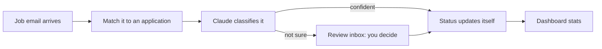

<h1 align="center">
  <a href="https://github.com/benjaminbelloeil/jobbear">
    <picture>
      <source media="(prefers-color-scheme: dark)" srcset="docs/brand/logo/lockup-on-dark.svg">
      <source media="(prefers-color-scheme: light)" srcset="docs/brand/logo/lockup.svg">
      
    </picture>
  </a>
</h1>

<p align="center">
  <b>The open-source job application tracker that reads your inbox.</b><br>
  Your pipeline updates itself: no spreadsheet, no copy-paste.
</p>

<p align="center">
  <a href="https://github.com/benjaminbelloeil/jobbear/actions/workflows/ci.yml"></a>
  <a href="LICENSE"></a>
  <a href="CONTRIBUTING.md"></a>
  <a href="https://github.com/benjaminbelloeil/jobbear/stargazers"></a>
</p>

<p align="center">
  <a href="#features">Features</a> ·
  <a href="#how-it-works">How it works</a> ·
  <a href="#quick-start">Quick start</a> ·
  <a href="docs/self-hosting.md">Self-hosting</a> ·
  <a href="#roadmap">Roadmap</a> ·
  <a href="#contributing">Contributing</a>
</p>

<br>

JobBear pulls job emails from Gmail, classifies them with the Claude API and moves each
application along on its own. You see your real pipeline: response rate, OA rate and time to
first reply.

> Built to replace my Notion + manual tracking while I apply to 5+ software engineering roles a day.

> [!NOTE]
> **In active development.** The interface runs on sample data today; the API, Gmail sync
> and AI classification are being built. See the [roadmap](#roadmap).

## Features

| | |
|---|---|
| **Applications and history** | Applications, companies and a full status history (Applied → OA → Interviewing → Offer) |
| **Reads your inbox** | Read-only Gmail sync with AI classification: rejection, OA invite, interview invite, offer |
| **Asks before it acts** | Low-confidence or unmatched emails go to a review inbox instead of changing a status on their own |
| **Ghosting detection** | Marks an application "Ghosted" after 21 days of silence (configurable) |
| **Real numbers** | Response, OA and interview rates, days to first reply, weekly volume vs. goal |
| **Easy to leave Notion** | Import from a Notion CSV export |
| **Yours to run** | Open source: self-host it for free, on your own AI key |

## How it works



Every status change is written to a history table, so the dashboard numbers always come from
what actually happened and when.

## Ways to use it

| | What you get | Cost |
|---|---|---|
| **Demo** | The full interface on sample data, no sign-up | Free |
| **[Self-hosted](docs/self-hosting.md)** | Everything, on your own machine, with your own AI key | Free, forever |
| **JobBear Cloud** *(planned)* | Hosted for you, AI included. 30- or 90-day passes, no auto-renew | One-time pass |

Every feature is in the open-source version. Cloud passes pay for convenience, not features.

## Quick start

```bash
git clone https://github.com/benjaminbelloeil/jobbear.git && cd jobbear
cp .env.example .env            # then fill in the values (see the self-hosting guide)
docker compose up -d --build
docker compose exec backend alembic upgrade head
```

Open http://localhost:5173. The full walkthrough, including Gmail, is in
[docs/self-hosting.md](docs/self-hosting.md).

## Tech stack

| Layer | Tech |
|---|---|
| Backend | Python 3.12, FastAPI, SQLAlchemy 2.0, Alembic, Pydantic v2 |
| Database | PostgreSQL 16 |
| Frontend | React, TypeScript, Vite, Tailwind CSS, TanStack Query, Recharts |
| AI and email | Claude API, Gmail API |
| Testing | pytest, Vitest, React Testing Library |
| DevOps | Docker Compose, GitHub Actions, Railway, Cloudflare Pages |

## Documentation

| | |
|---|---|
| [Self-hosting](docs/self-hosting.md) | Install, Gmail setup, settings, backups, troubleshooting |
| [Deploying](docs/deploying.md) | Railway + Cloudflare Pages |
| [Development](docs/development.md) | Architecture, project structure, tests |
| [Brand kit](docs/brand/README.md) | The bear, logos, colors and type |

## Roadmap

- [ ] Core CRUD + status history
- [ ] Dashboard analytics
- [ ] Gmail sync + Claude classification
- [ ] Deploy to Railway
- [ ] **v1.5** Save the job posting with each application (pasted, or filled from Greenhouse, Lever and Ashby links)
- [ ] **v2** Resume versions: which resume went where, and how each one performs
- [ ] **v2** Keyword match: which skills in the posting your resume covers, with the evidence
- [ ] Bring your own AI provider (OpenAI, Gemini, Grok, Ollama)
- [ ] Forwarding address, so any email provider works
- [ ] Production compose file for VPS hosting
- [ ] JobBear Cloud

## Contributing

Contributions are welcome. JobBear is also a learning project: the maintainer writes the core
backend (models, endpoints, services, integrations) himself, so **backend core changes start as
an issue**, not a pull request. Everything else is open to you:

- **Report a bug** with steps to reproduce
- **Improve the frontend**: components, styling, accessibility, responsive fixes
- **Improve the docs**: typos, guides, diagrams
- **Tooling and CI**: GitHub Actions, Docker, lint config

How to start:

1. Read [CONTRIBUTING.md](CONTRIBUTING.md) for the branch, commit and PR conventions, and the
   short contributor license agreement (CLA) you accept in the pull request template.
2. Set JobBear up locally with [docs/development.md](docs/development.md). You can run the
   frontend alone on sample data.
3. Open a small, focused pull request. CI runs the same checks you can run locally.

Please follow the [Code of Conduct](.github/CODE_OF_CONDUCT.md). Report security problems
privately, as described in [SECURITY.md](.github/SECURITY.md).

## License

[GNU AGPL-3.0](LICENSE). Use, modify and self-host JobBear freely. If you run a modified
version as a hosted service, you must publish your changes under the same license.

<!-- TODO(me): add a "What I learned" section after v1 ships. -->
