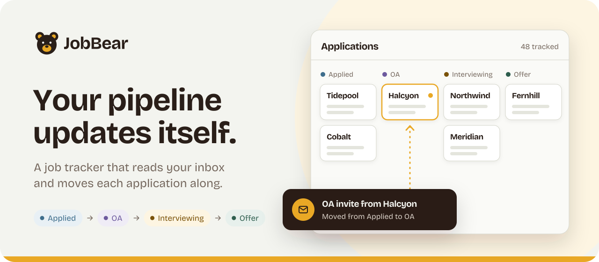
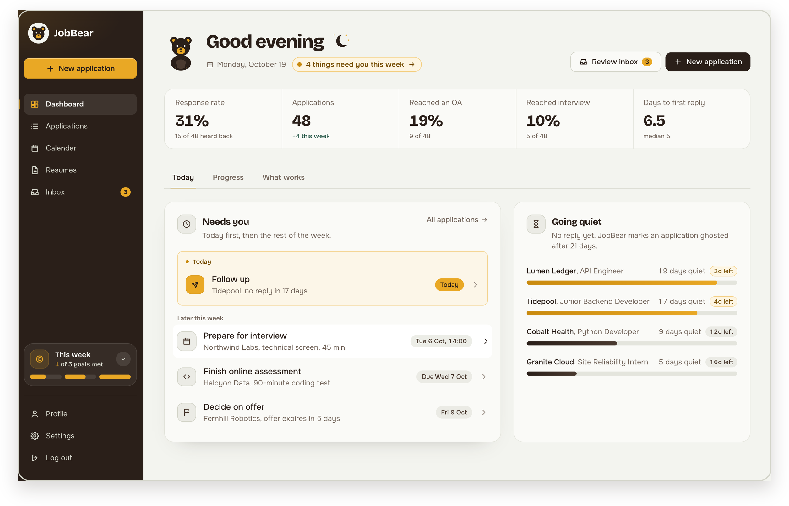
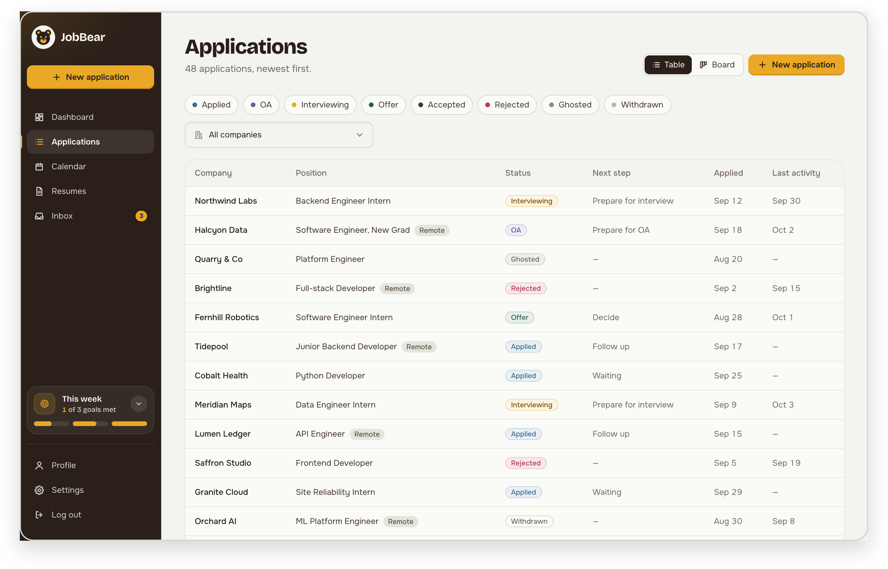
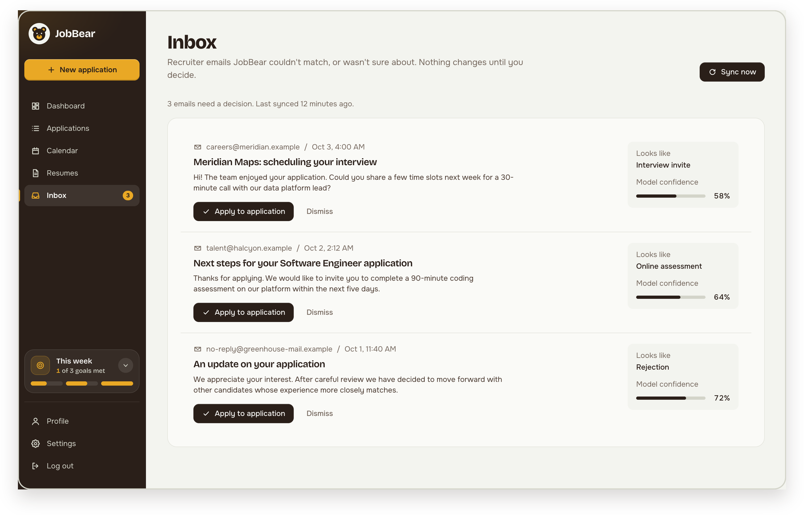
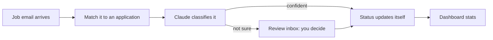
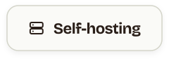

<p align="center">
  <picture>
    <source media="(prefers-color-scheme: dark)" srcset="docs/brand/readme/hero/hero-dark.svg">
    
  </picture>
</p>

<p align="center">
  <a href="docs/self-hosting.md"><picture><source media="(prefers-color-scheme: dark)" srcset="docs/brand/readme/buttons/self-host-dark.svg"></picture></a>
  <a href="#quick-start"><picture><source media="(prefers-color-scheme: dark)" srcset="docs/brand/readme/buttons/quick-start-dark.svg"></picture></a>
  <a href="docs/README.md"><picture><source media="(prefers-color-scheme: dark)" srcset="docs/brand/readme/buttons/docs-dark.svg"></picture></a>
  <a href="#roadmap"><picture><source media="(prefers-color-scheme: dark)" srcset="docs/brand/readme/buttons/roadmap-dark.svg"></picture></a>
</p>

<p align="center">
  <a href="https://github.com/benjaminbelloeil/jobbear/actions/workflows/ci.yml"></a>
  <a href="LICENSE"></a>
  
  
  <a href="CONTRIBUTING.md"></a>
</p>

<br>

JobBear pulls job emails from Gmail, classifies them with the Claude API and moves each
application along on its own. You see your real pipeline: response rate, OA rate and time to
first reply.

> Built to replace my Notion + manual tracking while I apply to 5+ software engineering roles a day.

> [!NOTE]
> **In active development.** The interface runs on sample data today; the API, Gmail sync
> and AI classification are being built. See the [roadmap](#roadmap).

## See it

<p align="center">
  
</p>

<table>
  <tr>
    <td width="50%" valign="top">
      
      <p><b>Every application, one place.</b> Status, next step and last activity at a glance, as a table or a board.</p>
    </td>
    <td width="50%" valign="top">
      
      <p><b>Nothing changes behind your back.</b> Emails the AI isn't sure about wait in a review inbox until you decide.</p>
    </td>
  </tr>
</table>

## What it does

| Feature | Details |
|---|---|
| **Tracks the whole story** | Applications, companies and a full status history: Applied → OA → Interviewing → Offer |
| **Reads your inbox** | Read-only Gmail sync. The Claude API sorts each email: rejection, OA invite, interview invite, offer |
| **Notices the silence** | Marks an application "Ghosted" after 21 days without a reply (configurable) |
| **Shows what works** | Response, OA and interview rates, days to first reply, weekly volume against your goal |
| **Moves in with you** | Imports your existing applications from a Notion CSV export |
| **Stays yours** | Open source. Self-host it for free, on your own AI key |

## How it works



Every status change is written to a history table, so the dashboard numbers always come from
what actually happened and when.

## Ways to use it

| | What you get | Cost |
|---|---|---|
| **Demo** | The full interface on sample data, no sign-up | Free |
| **[Self-hosted](docs/self-hosting.md)** | Everything, on your own machine, with your own AI key | Free, forever |
| **JobBear Cloud** *(planned)* | Hosted for you, AI included. 30- or 90-day passes, no auto-renew | One-time pass |

Every feature is in the open-source version. Cloud passes pay for convenience, not features.

## Quick start

```bash
git clone https://github.com/benjaminbelloeil/jobbear.git && cd jobbear
cp .env.example .env            # then fill in the values (see the self-hosting guide)
docker compose up -d --build
docker compose exec backend alembic upgrade head
```

Open http://localhost:5173. The full walkthrough, including Gmail, is in
[docs/self-hosting.md](docs/self-hosting.md).

## Tech stack

| Layer | Tech |
|---|---|
| Backend | Python 3.12, FastAPI, SQLAlchemy 2.0, Alembic, Pydantic v2 |
| Database | PostgreSQL 16 |
| Frontend | React, TypeScript, Vite, Tailwind CSS, TanStack Query, Recharts |
| AI and email | Claude API, Gmail API |
| Testing | pytest, Vitest, React Testing Library |
| DevOps | Docker Compose, GitHub Actions, Railway, Cloudflare Pages |

## Documentation

<p>
  <a href="docs/self-hosting.md"><picture><source media="(prefers-color-scheme: dark)" srcset="docs/brand/readme/buttons/guide-self-hosting-dark.svg"></picture></a>
  <a href="docs/deploying.md"><picture><source media="(prefers-color-scheme: dark)" srcset="docs/brand/readme/buttons/guide-deploying-dark.svg"></picture></a>
  <a href="docs/development.md"><picture><source media="(prefers-color-scheme: dark)" srcset="docs/brand/readme/buttons/guide-development-dark.svg"></picture></a>
  <a href="docs/brand/README.md"><picture><source media="(prefers-color-scheme: dark)" srcset="docs/brand/readme/buttons/guide-brand-dark.svg"></picture></a>
</p>

| Guide | What's in it |
|---|---|
| [Self-hosting](docs/self-hosting.md) | Install, Gmail setup, settings, backups, troubleshooting |
| [Deploying](docs/deploying.md) | Railway + Cloudflare Pages |
| [Development](docs/development.md) | Architecture, project structure, tests |
| [Brand kit](docs/brand/README.md) | The bear, logos, colors and type |

## Roadmap

- [ ] Core CRUD + status history
- [ ] Dashboard analytics
- [ ] Gmail sync + Claude classification
- [ ] Deploy to Railway
- [ ] **v1.5** Save the job posting with each application (pasted, or filled from Greenhouse, Lever and Ashby links)
- [ ] **v2** Resume versions: which resume went where, and how each one performs
- [ ] **v2** Keyword match: which skills in the posting your resume covers, with the evidence
- [ ] Bring your own AI provider (OpenAI, Gemini, Grok, Ollama)
- [ ] Forwarding address, so any email provider works
- [ ] Production compose file for VPS hosting
- [ ] JobBear Cloud

## Contributing

Contributions are welcome. JobBear is also a learning project: the maintainer writes the core
backend (models, endpoints, services, integrations) himself, so **backend core changes start as
an issue**, not a pull request. Everything else is open to you:

- **Report a bug** with steps to reproduce
- **Improve the frontend**: components, styling, accessibility, responsive fixes
- **Improve the docs**: typos, guides, diagrams
- **Tooling and CI**: GitHub Actions, Docker, lint config

How to start:

1. Read [CONTRIBUTING.md](CONTRIBUTING.md) for the branch, commit and PR conventions, and the
   short contributor license agreement (CLA) you accept in the pull request template.
2. Set JobBear up locally with [docs/development.md](docs/development.md). You can run the
   frontend alone on sample data.
3. Open a small, focused pull request. CI runs the same checks you can run locally.

Please follow the [Code of Conduct](.github/CODE_OF_CONDUCT.md). Report security problems
privately, as described in [SECURITY.md](.github/SECURITY.md).

## License

[GNU AGPL-3.0](LICENSE). Use, modify and self-host JobBear freely. If you run a modified
version as a hosted service, you must publish your changes under the same license.

<br>

<p align="center">
  <br>
  <sub>Made for everyone sending out applications. <a href="#readme">Back to top</a></sub>
</p>

<!-- TODO(me): add a "What I learned" section after v1 ships. -->
